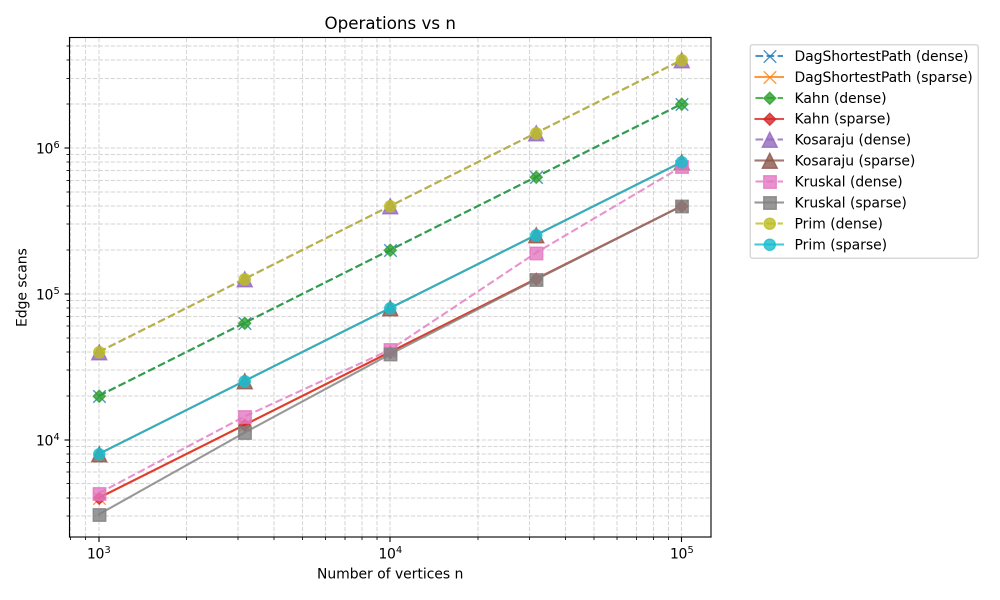
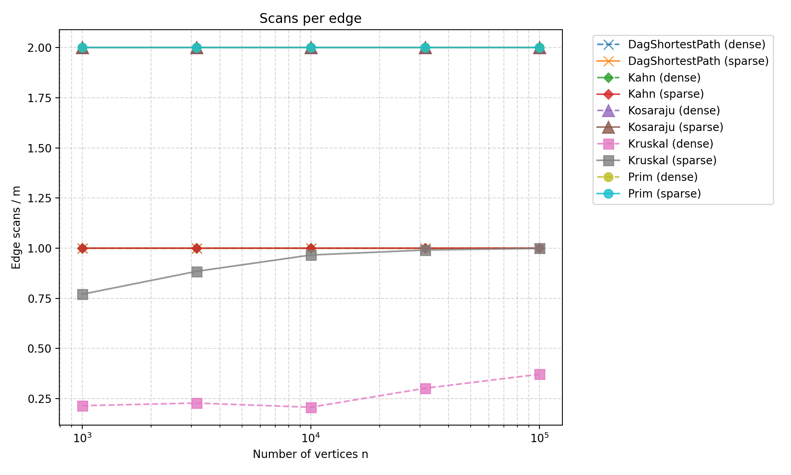
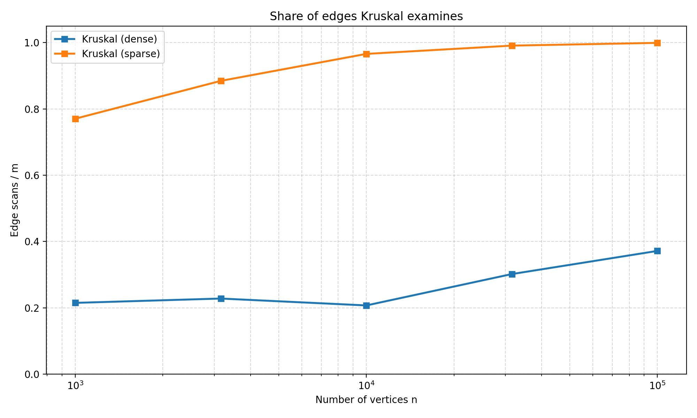

# Assignment 3 Report: DSU, MST, SCC and Shortest Paths in a DAG

All numbers below come from `results/results.csv` (one run of `BenchmarkRunner`, seed 42). The benchmark checks
itself: it stops if Kruskal and Prim disagree, if a topological order is invalid, if the traversal counters are not
exactly 2m (Kosaraju) or m (Kahn, DAG relaxation), or if any result differs from the reference table of the assignment.
All ten reference rows (MST weight, SCC count, sum of DAG distances) are reproduced exactly.

## 1. Complexity table

V = number of vertices, E = number of edges. "Extra space" is what the algorithm allocates beyond the input graph.

| Algorithm | Time | Extra space | Justification |
|---|---|---|---|
| DSU `find` / `union` | O(α(n)) amortized | O(n) | Union by size keeps trees at depth O(log n); path compression flattens every visited path, so m operations cost O(m α(n)). Arrays `parent` and `size`. |
| Kruskal | O(E log E) = O(E log V) | O(E + V) | One sort of the E edges dominates; the loop does at most 2 `find` and 1 `union` per edge, each almost constant. Sorted copy of the edges + DSU + result list. |
| Prim (lazy, `PriorityQueue`) | O(E log E) = O(E log V) | O(E + V) | Every adjacency entry (2E) is pushed once and polled once, each heap operation costs O(log E). The heap can hold up to 2E entries, plus a `used` array. |
| Kosaraju | O(V + E) | O(V + E) | Two full traversals, each vertex pushed once and each edge scanned once per pass (2E scans in total). Extra space: reversed graph, finish list, `seen`, explicit stack. |
| Kahn | O(V + E) | O(V) | In-degrees in one pass, then each vertex leaves the queue once and each edge is scanned once. Arrays `indegree`, queue and order list. |
| DAG shortest paths | O(V + E) | O(V) | One Kahn pass for the order, then one relaxation pass that scans every edge once. Arrays `dist`, `parent`, `indegree`, order. |

## 2. Counters against formulas

Each counter is divided by its formula. A ratio that stays bounded (flat or slowly changing) confirms the complexity class.
The traversal counters are deterministic, so their ratios are exactly flat.

| Algorithm | Ratio | Density | n=1000 | n=3162 | n=10000 | n=31623 | n=100000 |
|---|---|---|---|---|---|---|---|
| Kosaraju | edgeScans / (V+E) | sparse | 1.6000 | 1.6000 | 1.6000 | 1.6000 | 1.6000 |
| Kosaraju | edgeScans / (V+E) | dense | 1.9048 | 1.9048 | 1.9048 | 1.9048 | 1.9048 |
| Kahn | edgeScans / (V+E) | sparse | 0.8000 | 0.8000 | 0.8000 | 0.8000 | 0.8000 |
| Kahn | edgeScans / (V+E) | dense | 0.9524 | 0.9524 | 0.9524 | 0.9524 | 0.9524 |
| DAG shortest paths | edgeScans / (V+E) | sparse | 0.8000 | 0.8000 | 0.8000 | 0.8000 | 0.8000 |
| DAG shortest paths | edgeScans / (V+E) | dense | 0.9524 | 0.9524 | 0.9524 | 0.9524 | 0.9524 |
| Prim | edgeScans / E | both | 2.0000 | 2.0000 | 2.0000 | 2.0000 | 2.0000 |
| Prim | comparisons / (E log2 V) | sparse | 4.79 | 4.69 | 4.67 | 4.62 | 4.55 |
| Prim | comparisons / (E log2 V) | dense | 5.63 | 5.41 | 5.24 | 5.10 | 5.00 |
| Kruskal | dsuOps / E | sparse | 2.29 | 2.52 | 2.68 | 2.73 | 2.75 |
| Kruskal | dsuOps / E | dense | 0.58 | 0.61 | 0.56 | 0.75 | 0.89 |
| Kruskal | dsuOps / edgeScans | sparse | 2.97 | 2.85 | 2.78 | 2.76 | 2.75 |
| Kruskal | dsuOps / edgeScans | dense | 2.70 | 2.66 | 2.72 | 2.50 | 2.40 |
| Kruskal | comparisons / (E log2 E) | sparse | 0.89 | 0.91 | 0.87 | 0.81 | 0.74 |
| Kruskal | comparisons / (E log2 E) | dense | 0.90 | 0.85 | 0.78 | 0.72 | 0.67 |

Notes on the three non-flat rows:

- **Kosaraju, Kahn and DAG paths.** The ratios are constant per density, exactly as the formulas predict: 2E, E and E scans. They differ between sparse and dense only because E/(V+E) differs.
- **Kruskal `dsuOps / E`.** This ratio rises with n on sparse graphs because Kruskal stops as soon as the tree is complete, and the share of examined edges grows with n (section 5). Per examined edge the DSU work is flat and bounded: 2.4 to 3.0 operations (two `find` calls, plus the successful `union` with its own two `find` calls). That is the almost-constant α(n) cost.
- **Kruskal comparisons.** The ratio stays below 1 and does not grow, so E log E is an upper bound. It falls slowly because the weights are drawn from only 1000 distinct values, so large graphs contain many ties and the sort does fewer comparisons.
- **Prim comparisons.** The ratio stays between 4.5 and 5.6 and decreases slightly with n. The constant 4.5 to 5.6 comes from the heap holding up to 2E entries and from `poll` costing about two comparisons per level.

## 3. Correctness arguments

### Cut property (Kruskal and Prim)

A cut splits the vertices into two non-empty sets S and V \ S. Claim: let A be a set of edges contained in some minimum spanning tree T, let no edge of A cross the cut, and let e be a lightest edge crossing the cut. Then A + e is contained in some minimum spanning tree.
If e is already in T there is nothing to prove. Otherwise T + e contains exactly one cycle, and this cycle crosses the cut at e, so it must cross it again at another edge f of T.
Because e is a lightest crossing edge, w(e) <= w(f), so T' = T - f + e is a spanning tree with weight at most w(T), hence also minimum. Since A has no crossing edge, f is not in A, and T' contains A + e.
Kruskal uses this when it takes an edge with find(u) != find(v): the cut is (component of u, everything else), no chosen edge crosses it, and every lighter edge was already processed and either chosen or lies inside one component, so the current edge is a lightest crossing edge.
Prim uses it with the cut (vertices in the tree, the rest): the priority queue returns the lightest edge leaving the tree, and entries whose endpoint is already in the tree are skipped. Ties only make the trees differ, never the total weight, which is why the benchmark compares weights.

### Induction on the topological order (one relaxation pass)

Claim: when vertex v is taken in topological order, `dist[v]` is already the length of a shortest path to v from a vertex of in-degree 0 (the virtual super-source with weight 0).
Induction on the position of v. The first vertex has no incoming edges, so `dist = 0` is final.
For any later v, every edge (u, v) has u before v in the order, so all incoming edges of v were relaxed before v is processed, and by the induction hypothesis each `dist[u]` was final at that moment.
Any path to v ends with some edge (u, v) and therefore has length at least `dist[u] + w(u, v)`, which is at least `dist[v]` after the relaxation; and `dist[v]` is the length of a real path (the `parent` chain), so the two are equal.
No edge enters v from a later vertex, so v never needs to be visited again; one pass over the vertices and their outgoing edges is enough, O(V + E).

### Why negative weights are safe in a DAG but not in a general graph

The proof above never uses w >= 0. Dijkstra's algorithm does: it finalizes the closest vertex because a later path cannot be shorter, and a negative edge breaks that. In a general graph a negative cycle makes distances undefined (arbitrarily small), and even without one, label-setting is wrong. A DAG has no cycles, so there is no negative cycle, and the topological order guarantees that all incoming edges of a vertex have been relaxed before it is finalized. In a general graph with negative weights you need Bellman-Ford, O(V E).

## 4. Which algorithm when

| Situation | Choice | Why |
|---|---|---|
| Undirected, sparse (E close to V), graph given as an **edge list** | Kruskal | Needs only the edge list and a DSU; one sort. On sparse graphs it examines almost every edge (99.9% at n = 100 000), but still did far less work than Prim here. |
| Undirected, **dense** (E close to V^2) | Prim with a heap that supports decrease-key, or the O(V^2) array version; Kruskal if only an edge list exists | Kruskal examines only 21% to 37% of the sorted edges before the tree is complete (section 5), but it must sort all of them. Our Prim is the lazy `PriorityQueue` version from the lecture, which pushes every adjacency entry, so in our measurements Kruskal needed fewer comparisons on both densities (27.9 M against 166 M at n = 100 000, dense). |
| Graph may be **disconnected** | Kruskal or Prim, both return a forest | Component count is `dsu.components()` for Kruskal and the number of start vertices for Prim. |
| **Adjacency list** available, tree grows from a root | Prim | Natural fit, no global sort. |
| Directed, **cycle possible**, need a processing order | Kahn | Fewer than V vertices leaving the queue means a cycle, reported instead of a wrong order. |
| Directed, find **deadlocks** (mutually dependent jobs) | Kosaraju (or Tarjan) | Strongly connected components, O(V + E), iterative DFS safe at 100 000 vertices. |
| Weighted **DAG**, fastest route, negative weights allowed | DAG shortest paths | One pass in O(V + E); Dijkstra is wrong with negative edges, Bellman-Ford is O(V E). |
| Weighted graph with cycles and negative edges | Bellman-Ford (not part of this project) | The DAG algorithm needs a topological order, which a cyclic graph does not have. |
| Edges arrive one by one, only connectivity is asked | DSU alone | Near-constant cost per edge, no graph structure needed. |

## 5. Slope check

On log-log axes a straight line of slope 1 means linear work. Least-squares slope of `edgeScans` against n over the five sizes:

| Algorithm | sparse | dense |
|---|---|---|
| Kosaraju | 1.000 | 1.000 |
| Kahn | 1.000 | 1.000 |
| DAG shortest paths | 1.000 | 1.000 |
| Prim | 1.000 | 1.000 |
| **Kruskal** | **1.055** | **1.119** |

The traversals give exactly 1.00. Kruskal is steeper because it stops once the tree is complete: in a random graph the sorted edges must reach about (n ln n) / 2 positions before every vertex is connected, so the share of examined edges grows with n. It rose from 0.77 to 0.999 on sparse graphs and from 0.22 to 0.37 on dense graphs. That is the log factor showing up in the scan count. The slope of Kruskal's `comparisons` (the sort) is 1.055 on sparse and 1.016 on dense graphs, also slightly above 1 because of E log E.

## 6. Plots

Kahn and DAG shortest paths coincide exactly (E scans), and so do Kosaraju and Prim (2E scans), so one marker sits on top of the other.

Kahn and the DAG relaxation sit at 1, Kosaraju and Prim at 2, all flat. Kruskal is below 1 and rises slowly.

On sparse graphs Kruskal ends up reading almost all edges; on dense graphs only about a fifth to a third of them. This is where Kruskal gains most from stopping early.

## 7. Time

In the benchmark run, at n = 100 000 on dense graphs, Kruskal took about 0.5 s, Prim about 3.3 s, Kosaraju about 0.9 s, Kahn about 0.1 s and the DAG shortest paths about 0.2 s; these are medians of 5 runs inside one JVM. These values depend on the hardware, the JVM version, JIT warm-up, garbage collection and whatever else is running on the machine, and on the two smallest graphs the clock mostly measures noise. For that reason the conclusions of this report rest on the operation counters, which are identical on every machine: the time only agrees with them in order of magnitude (Prim does the most comparisons and is the slowest, Kahn scans the fewest edges and is the fastest).
